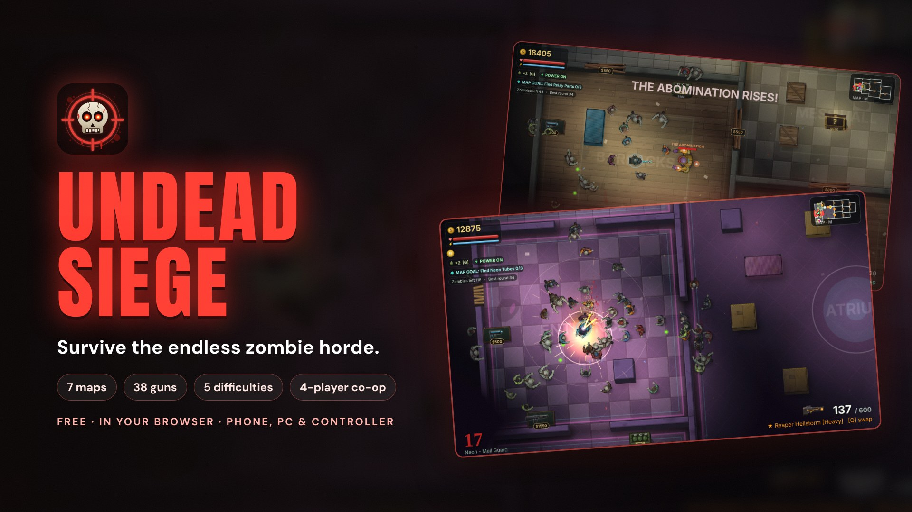
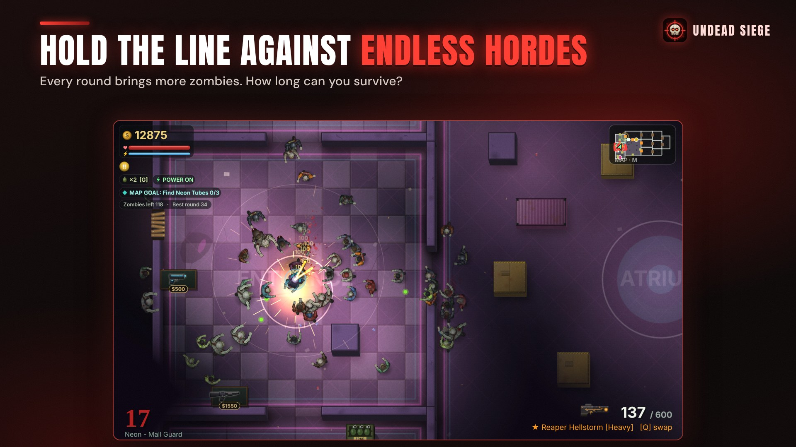
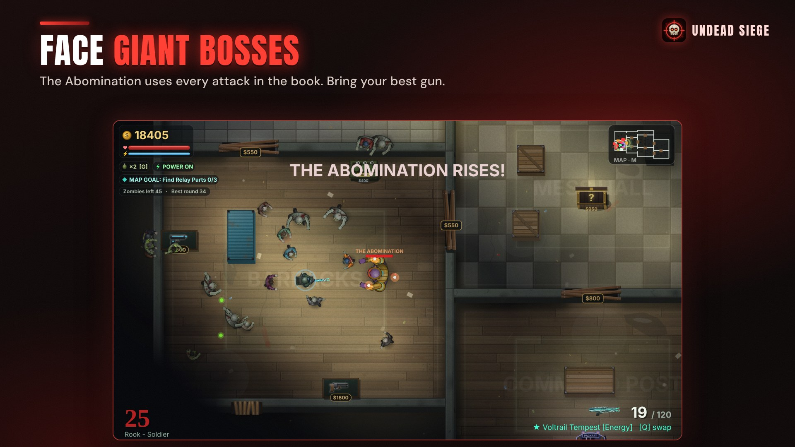
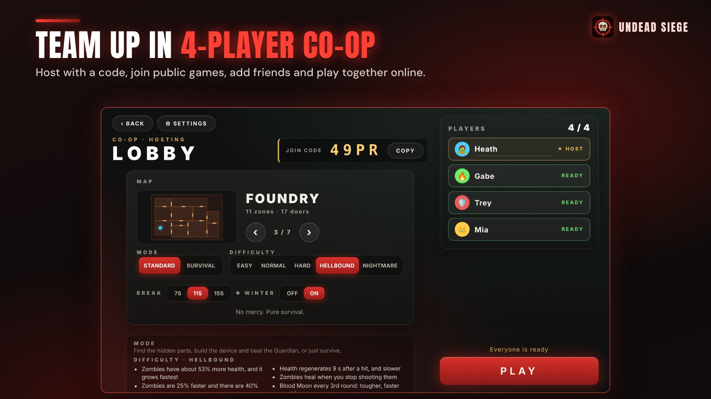
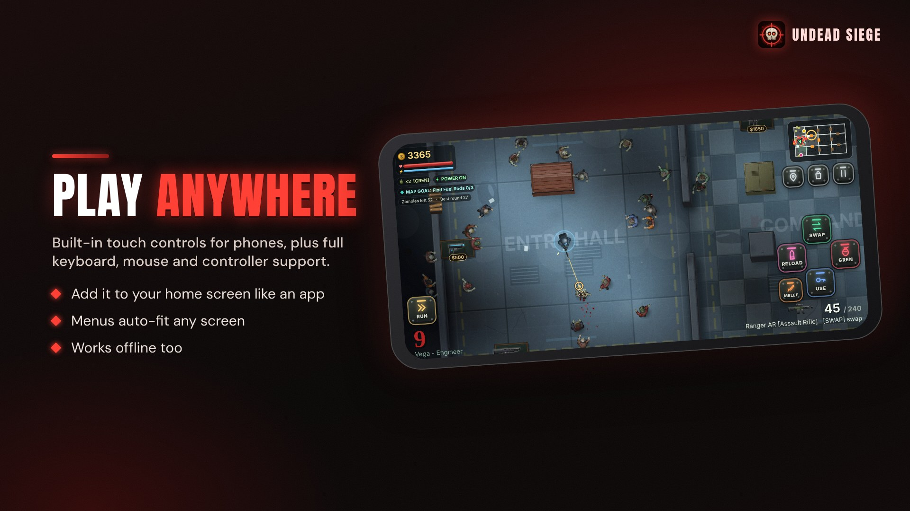
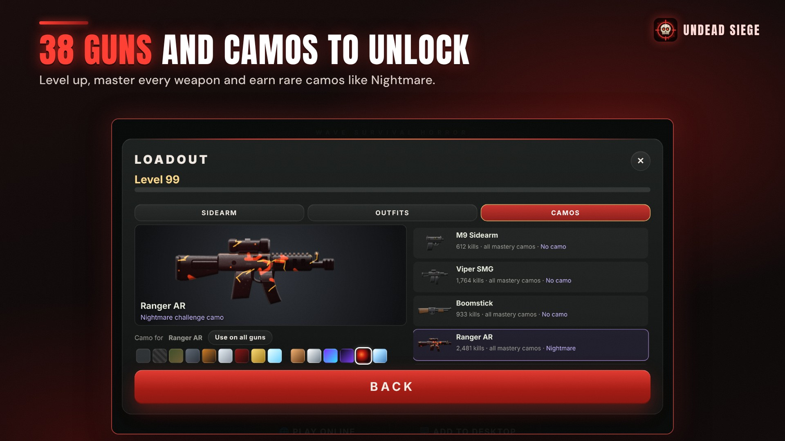
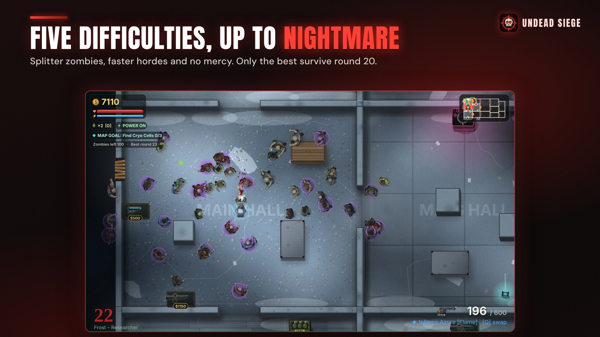
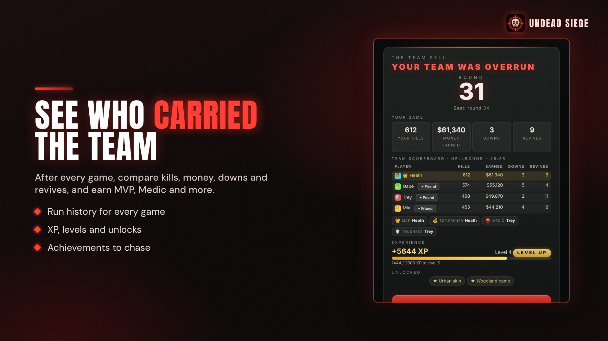

<h1 align="center">Undead Siege</h1>

<b>A free top-down zombie wave survival game that plays in your browser, with online co-op.</b>

<a href="https://littlelemons16.github.io/undead-siege/"><b>▶ Play now</b></a> · No download, no account · Phone, PC &amp; controller

## Features

- 🧟 **Endless waves**: survive as many rounds as you can against faster, tougher hordes
- 👹 **Boss fights**, including the Abomination
- 👥 **4-player online co-op**: private games with a code, public games, friends list and quick chat
- 🔫 **38 guns**, an upgrade machine, perks, a Mystery Crate and camos to unlock
- 🗺️ **7 maps**, each with its own hidden goal
- 💀 **5 difficulties**, from Easy to Nightmare
- 📱 **Plays anywhere**: touch controls, keyboard and mouse, or a controller. Add it to your home screen like an app

## Screenshots

 
 
 

## Feedback

Found a bug or have an idea? Use **Feedback** in the game's main menu, or [open an issue](https://github.com/LittleLemons16/undead-siege/issues/new).
